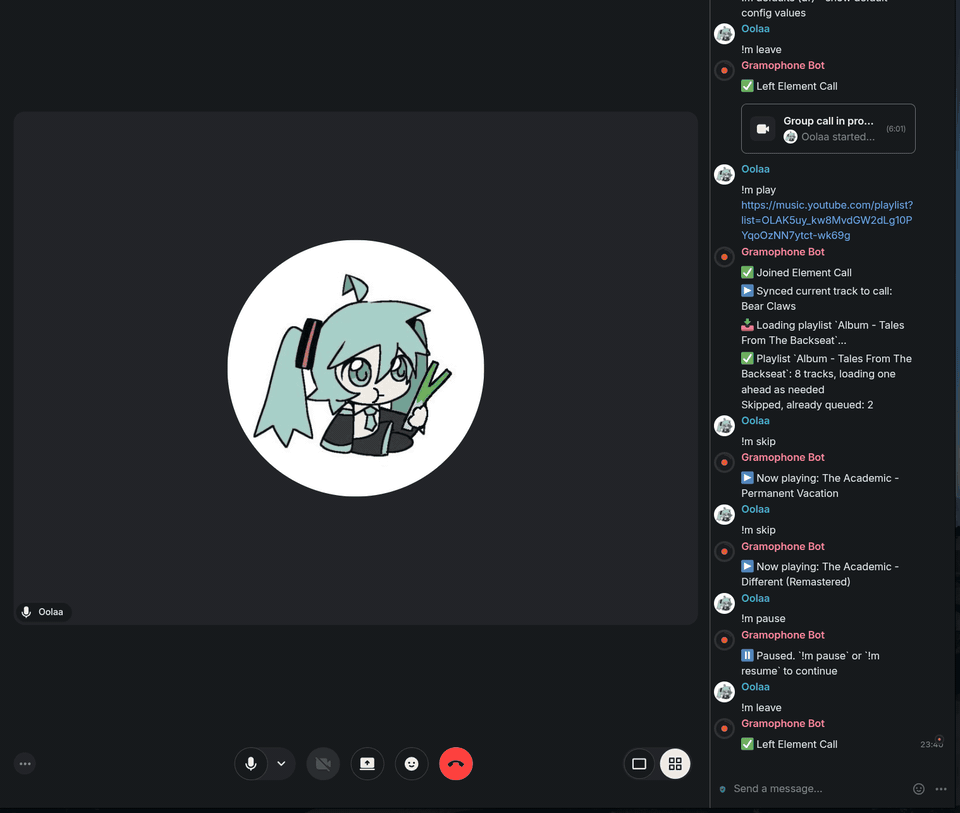

# Matrix Element Call MusicBot

Discord-style music bot for Matrix: chat commands (`!m play`, `!m queue`, `!m skip`, …) plus real playback in Element Call.

<p align="center">
  
</p>

Originally based on [SultanAlburaq/matrix-element-call-musicbot](https://github.com/SultanAlburaq/matrix-element-call-musicbot); this version adds room and call audio E2EE, cross-signing, search, translations, scrobbler events, an updated call worker and more.

Related projects:
- [matrix-element-call-scrobbler](https://github.com/OolaaPleur/matrix-element-call-scrobbler) — scrobbles what this bot plays to Last.fm for everyone in the call
- [matrix-element-call-common](https://github.com/OolaaPleur/matrix-element-call-common) — shared cross-signing code

> [!TIP]
> Issues and pull requests are welcome: bug reports, ideas, translations, fixes. [Open an issue](https://github.com/OolaaPleur/matrix-element-call-musicbot/issues) · [pull requests](https://github.com/OolaaPleur/matrix-element-call-musicbot/pulls)

## Contents

- [Features](#features)
- [Install](#install)
- [Commands](#commands)
- [Configuration](#configuration)
- [Companion Scrobbler Bot](#companion-scrobbler-bot)
- [Cross-Signing](#cross-signing) · [Verifying the bot](#verifying-the-bot-recommended)
- [Troubleshooting](#troubleshooting)
- [Data and Backups](#data-and-backups)
- More in `docs/`: [encryption details](docs/e2ee.md) · [running without Docker](docs/install-raw.md) · [data and token rotation](docs/data.md)

## Features

- Chat commands in Matrix rooms, messages in English or Russian (per room) or your own translation
- Plays in Element Call: stereo, configurable Opus bitrate
- YouTube links, search, playlists and channels; Spotify links looked up on YouTube
- Queue with ETA, play-next, shuffle, loop, history and saved queues
- Logarithmic volume, fade-in, normalization
- Full Matrix E2EE with cross-signing; encrypted call audio, like Element Call's own
- Optional track events for the companion Last.fm scrobbler

Current limitation: plays in one room at a time (one call session per bot).

## Install

You need a Matrix account for the bot, Git and Docker with Compose v2 (`docker compose version` must work; on Windows see [Prerequisites on Windows](#prerequisites-on-windows)). The bot runs from the prebuilt image `ghcr.io/oolaapleur/matrix-element-call-musicbot`; the clone only provides `docker-compose.yml` and the example config.

`scripts/setup.py` asks for the bot's user ID and password and for your own user ID (the bot joins rooms you invite it to; Enter to skip). It logs the bot in (the login is kept in the data volume, the config holds no secrets), restores the cross-signing keys with the account's recovery key ([Cross-Signing](#cross-signing)) and creates the call worker's device for encrypted call audio. Run it again if a step failed: done steps are skipped.

### Linux

```bash
git clone https://github.com/OolaaPleur/matrix-element-call-musicbot
cd matrix-element-call-musicbot

cp config/config.example.toml config/config.toml
nano config/config.toml          # settings (optional, the defaults work)
                                 # e.g. [bot] scrobbler_events = true for the companion scrobbler

docker compose run --rm musicbot python3 scripts/setup.py   # login, cross-signing keys, call worker device
docker compose up -d             # start the bot
docker compose logs -f           # watch it start (Ctrl+C to stop watching)
```

Podman works too: use `podman compose` instead of `docker compose` (it needs `podman-compose` or `docker-compose` installed).

Then invite the bot to a room and type `!m help`.

Update to the latest version:

```bash
git pull
docker compose pull
docker compose up -d
```

To change setup's answers later (another bot account, who may invite it, the cross-signing keys, the call worker device), stop the bot and run setup again: when everything is set up, it asks what to change.

```bash
docker compose stop
docker compose run --rm musicbot python3 scripts/setup.py
docker compose up -d
```

### Windows (PowerShell)

Linux is the recommended host for the bot (a server, VPS or home machine that runs 24/7); use Windows only if you have no Linux machine. Tested on Windows 11 Home with Docker Desktop (WSL 2) and Windows PowerShell 5.1.

Don't join the call from the same Windows PC the bot runs on: listening there can cause short audio stutters. Listen from another device.

#### Prerequisites on Windows

In a normal (not administrator) PowerShell; each installer asks for administrator rights itself:

```powershell
winget install --id Git.Git -e
wsl --install --no-distribution
winget install --id Docker.DockerDesktop -e
```

Then **reboot**. `--no-distribution` installs only the WSL 2 platform that Docker Desktop needs, no Linux distribution; you never have to open WSL yourself. If Docker Desktop says *Virtual Machine Platform is not enabled* right after the install, you skipped the reboot.

Start Docker Desktop and wait for **Engine running**, then open a **new** PowerShell window, so `git` and `docker` are found. Docker Desktop has to run whenever the bot runs: enable Settings → General → *Start Docker Desktop when you sign in to your computer*.

#### Install

```powershell
git clone https://github.com/OolaaPleur/matrix-element-call-musicbot
Set-Location .\matrix-element-call-musicbot

Copy-Item .\config\config.example.toml .\config\config.toml
notepad .\config\config.toml     # settings (optional, the defaults work)
                                 # e.g. [bot] scrobbler_events = true for the companion scrobbler

docker compose run --rm musicbot python3 scripts/setup.py
docker compose up -d
docker compose logs -f
```

Updating and changing setup's answers work with the same commands as on Linux.

### Other ways

- **Build the image yourself** (e.g. with your own changes): uncomment `build: .` in `docker-compose.yml` and run `docker compose up -d --build`. The build fetches the shared library from GitHub, no second clone needed.
- **Without Docker** (Linux): see [docs/install-raw.md](docs/install-raw.md), including a systemd unit.

## Commands

All commands start with the prefix (`!m` by default); the short form is in brackets, e.g. `!m p` = `!m play`.

<p align="center">
  
</p>

The ones you need most:

| Command | What it does |
|---|---|
| `!m play <url or search>` | Play a link (YouTube, YouTube Music, Spotify) or the first search result; joins the call |
| `!m search <query>` | List 5 results, then `!m play <n>` |
| `!m queue` | Show the queue with ETA |
| `!m skip` · `!m pause` · `!m stop` | Skip, pause/resume, stop and clear the queue |
| `!m volume <0-200>` | Playback volume |
| `!m leave` | Leave the call |
| `!m help` | All commands |

<details>
<summary>All commands</summary>

#### Playback

- `!m help` (`h`) — show this help
- `!m join` (`j`) — join Element Call in this room
- `!m leave` (`lv`) — leave current Element Call
- `!m play` (`p`) `<url-or-query>` — add track and auto-join call if needed
  - Spotify links (tracks, albums, playlists, artists; first 100 tracks, no podcasts) are looked up on YouTube by artist + title
- `!m playnext` (`pn`, `next`) `<url-or-query>` — add a single track to the front of the queue
- `!m search` (`sr`, `find`) `<query>` — list the top 5 YouTube results; then `!m play <n>` or `!m playnext <n>` (for 5 minutes)
- `!m queue` (`q`) — show queue with ETA, and the playlist tracks not loaded yet
- `!m remove` (`rm`) `<n>` — remove track n from the queue
- `!m nowplaying` (`np`) — show current track
- `!m skip` (`s`) — skip current track
- `!m pause` (`ps`) — pause; run it again (or `!m resume`, `rs`) to continue from the same spot
- `!m stop` (`x`) — stop playback and clear queue
- `!m loop` (`lp`) — toggle loop mode
- `!m shuffle` (`sh`, `random`) — shuffle the upcoming tracks (also the not-yet-downloaded rest of a playlist or saved queue)
- `!m history` (`hist`) — show recent playback history

#### Saved Queues

- `!m save` (`sv`) `<name> [--force]` — save current+upcoming queue
- `!m load` (`ld`) `<name>` — load a saved queue
- `!m queues` (`qs`) — list saved queues
- `!m deletequeue` (`dq`) `<name>` — delete a saved queue
- `!m renamequeue` (`rq`) `<old> <new>` — rename a saved queue

#### Audio & Info

- `!m audio` (`a`) — show current audio settings
- `!m normalize` (`norm`) `on|off` — toggle normalization
- `!m fadein` (`fi`) `<ms>` — set fade-in (0–5000)
- `!m volume` (`v`) `<0-200>` — set playback volume percent (logarithmic up to 100: 50% = −12 dB, about half as loud; linear above, 200% = +6 dB)
- `!m lang` `[code|default]` — show or set the language of the bot's messages in this room
- `!m status` (`st`) — show bot status
- `!m diag` (`d`) — show diagnostics
- `!m config` (`cfg`) — show active config
- `!m defaults` (`df`) — show default config values

</details>

## Configuration

Every setting is listed with its default in [`config/config.example.toml`](config/config.example.toml) (`!m defaults` shows them too, `!m config` the active values). Restart the bot after a change. The ones you are most likely to touch (stereo, bitrate, proxy, search and streaming options are in the example config):

| Setting | Default | What it does |
|---|---|---|
| `bot.command_prefix` | `"!m"` | Command prefix, e.g. `"!music"` or `"!dj"` |
| `bot.auto_accept_invites_from` | the users from setup | Users whose room invites the bot accepts, e.g. `["@you:matrix.org", "@friend:matrix.org"]`; replaces the ones from setup (or change them by running setup again) |
| `bot.auto_accept_invites` | `false` | Accept invites from anyone (only when `auto_accept_invites_from` is empty) |
| `bot.language` | `"en"` | Language of the bot's messages; `!m lang` overrides it per room (see [Languages](#languages)) |
| `bot.scrobbler_events` | `false` | Track events for the [scrobbler bot](#companion-scrobbler-bot) |
| `audio.volume_percent` | `100` | Start volume, 0–200 (logarithmic up to 100) |
| `audio.ytdlp_cookies_file` | unset | Cookies for yt-dlp when YouTube asks to sign in (see [Troubleshooting](#troubleshooting)) |
| `logging.level` | `"INFO"` | `DEBUG` for troubleshooting; the `LOG_LEVEL` environment variable overrides it |
| `worker.e2ee` | `"auto"` | Call audio encryption: `auto` = on once the worker device exists, `true` = on and complain in the room if it can't be, `false` = off ([details](docs/e2ee.md#call-audio-e2ee)) |

### Languages

The bot's messages come from `locales/<code>.toml` (`en` is the complete reference, `ru` ships too). `bot.language` is the default; `!m lang <code>` sets the language of one room (`!m lang default` goes back to the config default).

To change some messages, edit `locales/custom/en.toml` or `locales/custom/ru.toml`: every message is listed there commented out; uncomment a line, change the text, restart. A new language goes into `locales/custom/<code>.toml` too: copy `locales/en.toml`, set `language_name`, translate. Missing keys fall back to English (with a warning in the log). Plural forms are tables keyed by `count`: `{ one = "…", other = "…" }`, Russian `{ one, few, many }`.

## Companion Scrobbler Bot

[matrix-element-call-scrobbler](https://github.com/OolaaPleur/matrix-element-call-scrobbler) scrobbles what this bot plays to Last.fm, for everyone in the call. Set `[bot] scrobbler_events = true` and put both bots in the same room. The bot then sends `dev.elementcall.musicbot.track_started` / `track_finished` room events; they are off by default because each track costs two extra sends against the homeserver's rate limit. The scrobbler uses `!fm`, so the prefixes don't collide.

## Cross-Signing

The bot signs its own device with the account's cross-signing keys, so its messages don't show "encrypted by a device not verified by its owner". `scripts/setup.py` takes care of the keys:

- **The account was set up in Element** (the usual case: Element asked you to set up recovery when you created the account): setup asks for that **recovery key** to restore the keys.
- **A fresh account** with no keys yet: the bot creates them on first start.
- **Keys but no recovery key:** the bot can replace them, see [docs/e2ee.md](docs/e2ee.md#cross-signing-keys).

**After a reinstall** (or a lost `data/`), log the bot's old sessions out: in Element logged in as the bot, Settings → Sessions, sign out every session but the current ones (the bot's and the call worker's). Otherwise they can show as unverified sessions of the bot.

### Verifying the bot (recommended)

Verification adds the green shield: it confirms to you that this bot is really yours. It takes a minute, by comparing emoji:

1. Log in to Element as the bot in a separate browser or a private window (e.g. [app.element.io](https://app.element.io)); skip this if the bot's account is still logged in from when you created it. If Element asks to verify that session, use the recovery key; **never choose "Reset"**, that would replace the keys the bot uses.
2. In your own Element, open the bot's profile → **Verify**.
3. Accept the request in the bot's session and check that both sides show the same emoji.
4. Done. You can log the bot's Element session out afterwards; the bot itself is not affected.

## Troubleshooting

**`failed to connect to the docker API at npipe:////./pipe/docker_engine`** (Windows). Docker Desktop isn't running: start it and wait for *Engine running*.

**Short audio stutters when the bot runs on Windows.** If you listen to the call on the same PC the bot runs on, the audio can drop for a fraction of a second now and then. Listen from another device (phone, tablet, another PC).

**"Sign in to confirm you're not a bot" from YouTube.** YouTube wants a signed-in session from your server's IP. Export cookies of a YouTube session from your browser in Netscape format (e.g. with a "cookies.txt" extension), point `audio.ytdlp_cookies_file` at the file and restart. If yt-dlp later says the cookies are no longer valid, export them again (or comment the setting out).

**Replies take several seconds.** Usually the homeserver's rate limit (`429` in the log): every message and event the bot sends counts. Turn `bot.scrobbler_events` off if you don't run the scrobbler.

**"e2ee OFF, playing unencrypted".** The worker log says why; the fixes are in [docs/e2ee.md](docs/e2ee.md#e2ee-off-playing-unencrypted).

**`UnsupportedStickyEventsEndpointError` when joining a call.** The homeserver doesn't support MatrixRTC sticky events yet. The worker falls back to legacy mode by itself and says so in the room; in legacy mode normal rooms may need the bot at power level 50 (Moderator), video rooms work without it. To force legacy mode, set `[worker] membership_mode = "legacy"`; the long-term fix is a homeserver with sticky events (then `matrix2_auto`).

## Data and Backups

Everything the bot keeps lives in `data/` (the `musicbot_data` volume with Docker): its login, E2EE keys, cross-signing keys, saved queues and room languages. Back it up while the bot is stopped; the crypto files can't be recreated without side effects. Downloaded tracks (`musicbot_cache`) can be left out. What each file is, and how to rotate the access token: [docs/data.md](docs/data.md).

## License

MIT — see [LICENSE](LICENSE). Based on [SultanAlburaq/matrix-element-call-musicbot](https://github.com/SultanAlburaq/matrix-element-call-musicbot) (MIT).
