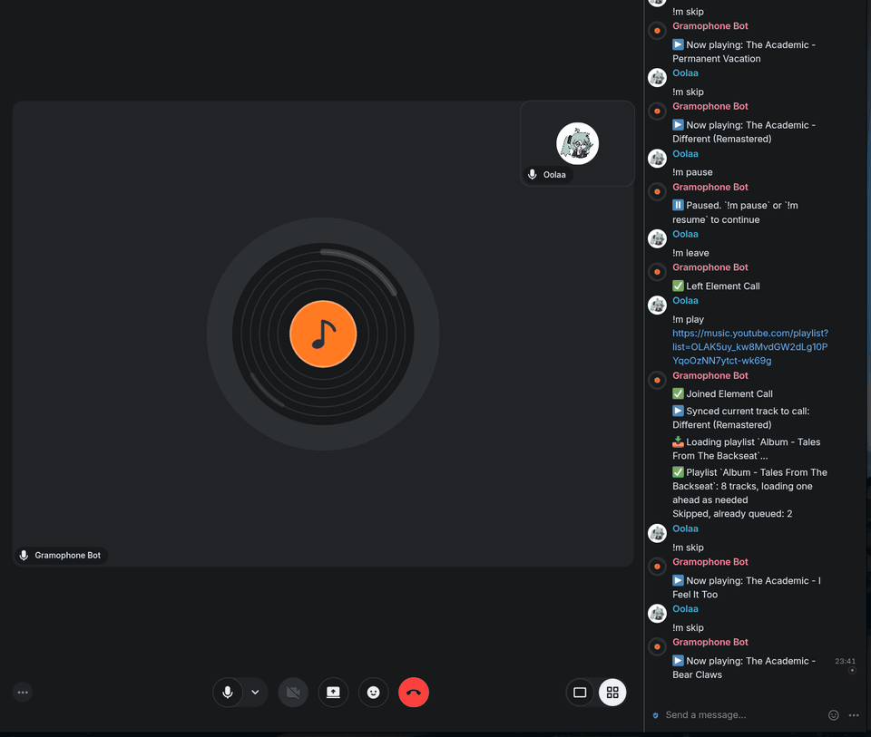

# Matrix Element Call MusicBot

Discord-style music bot UX for Matrix: chat commands (`!m play`, `!m queue`, `!m skip`, etc.) plus real playback in Element Call.

Originally based on [SultanAlburaq/matrix-element-call-musicbot](https://github.com/SultanAlburaq/matrix-element-call-musicbot); this version adds Matrix room and call audio E2EE, cross-signing, search, translations, scrobbler events, an updated call worker and more.

Related projects:
- [matrix-element-call-scrobbler](https://github.com/OolaaPleur/matrix-element-call-scrobbler) — scrobbles what this bot plays to Last.fm for everyone in the call
- [matrix-element-call-common](https://github.com/OolaaPleur/matrix-element-call-common) — shared cross-signing code

## Features

- Discord-style chat command workflow in Matrix rooms
- Joins Element Call and plays audio directly in call, stereo with a configurable Opus bitrate
- URL or search-based playback with queue and ETA; `search` lists results to pick from, `playnext` jumps the queue
- YouTube / YouTube Music playlists and channels, loaded one track ahead; `queue` lists the tracks not loaded yet
- Spotify links, played by looking the tracks up on YouTube
- Saved queue presets (`save`, `load`, `rename`, `delete`)
- Playback history and now-playing visibility
- Audio controls (logarithmic volume, fade-in, normalization)
- Configurable download format (`wav`, `mp3`, `ogg`, `m4a`, `opus`)
- Built-in diagnostics and runtime status commands
- Chat messages in English or Russian (per room), plus your own translations
- Full Matrix E2EE support — works in encrypted rooms, commands and messages are end-to-end encrypted
- Optional call audio E2EE, like Element Call's own
- Optional track events for a companion Last.fm scrobbler bot

## Configurable Command Prefix

The default prefix is `!m` — all commands are `!m play`, `!m skip`, `!m help`, etc.
Shorthands work too: `!m p`, `!m s`, `!m h`.

To change the prefix, set in `config.toml`:
```toml
[bot]
command_prefix = "!m"   # change to anything, e.g. "!music" or "!dj"
```

## Configuration Highlights

Every setting is listed with its default in [`config/config.example.toml`](config/config.example.toml) (`!m defaults` shows them too, `!m config` the active values). The ones you are most likely to touch:

| Setting | Default | What it does |
|---|---|---|
| `bot.language` | `"en"` | Language of the bot's messages; `!m lang` overrides it per room (see [Languages](#languages)) |
| `bot.scrobbler_events` | `false` | Track events for the [scrobbler bot](#companion-scrobbler-bot) |
| `audio.volume_percent` | `100` | Start volume, 0–200 (logarithmic up to 100) |
| `audio.ytdlp_cookies_file` | unset | Cookies for yt-dlp when YouTube asks to sign in (see [Troubleshooting](#troubleshooting)) |
| `audio.proxy` | `""` | Proxy for yt-dlp |
| `audio.search_mode` | `"fast"` | `fast`: short network timeouts and search results cached in memory (the same query plays the same track without asking YouTube again); `accurate`: always asks again, no short timeouts |
| `audio.stream_first_idle` | `true` | When nothing is playing, start streaming the track right away instead of downloading it first; the file is fetched in the background (`stream_prefetch_current`) and used if the stream fails (`stream_retry_to_file_on_fail`) |
| `worker.stereo` | `true` | Two-channel audio in the call; `false` = mono, like a voice call |
| `worker.audio_bitrate_kbps` | `128` | Opus bitrate of the music; `0` = LiveKit's default (voice-oriented, lower) |
| `worker.e2ee` | `"auto"` | [Call audio E2EE](#call-audio-e2ee-optional): `auto` = on once the worker device exists, `true` = on and complain in the room if it can't be, `false` = off |
| `ui.quiet_mode` | `true` | Drop progress chatter ("Searching…", "Downloading…", "Skipping…"); answers and errors are always sent |

## E2EE

Matrix room E2EE is **fully supported** — the bot decrypts encrypted commands and encrypts its own messages. Cross-signing is bootstrapped automatically on startup so the bot user shows as verified in Element.

The bot does not subscribe to other participants' tracks (`autoSubscribe: false`), so it never receives anyone's voice.

### Call audio E2EE (optional)

The call worker can encrypt the music like Element Call does (LiveKit SFrame, per-participant keys exchanged over Olm). With the default `[worker] e2ee = "auto"` this switches on by itself once the worker device below exists, and stays silently off before that; `true` insists on it (and says so in the room when it can't), `false` turns it off. It needs:

1. **A device of its own.** The keys travel as Olm-encrypted to-device messages, and the bot's own device belongs to matrix-nio, so the worker logs in as a second device of the same account. Create it once (asks for the bot's password, writes `data/worker_device.json`, mode 600):

   ```bash
   systemctl --user stop matrix-musicbot      # the script refuses while the bot runs
   scripts/create_worker_device.py            # --replace for a new one
   ```

   With Docker (the file goes into the `musicbot_data` volume):

   ```bash
   docker compose stop musicbot
   docker compose run --rm musicbot python3 scripts/create_worker_device.py
   docker compose up -d
   ```

   Its Olm identity is kept in `data/worker_crypto_store.v8` (matrix-js-sdk rust crypto on [fake-indexeddb](https://github.com/dumbmatter/fakeIndexedDB), snapshotted to disk; no native modules). The worker cross-signs it with `data/cross_signing_keys.json` on start.

2. **A fix in `@livekit/rtc-node`.** Released versions (1.2.x) can't take a key from the application ([livekit/node-sdks#768](https://github.com/livekit/node-sdks/pull/768)). The Docker image applies it at build time; on the host, apply it after every `bun install`:

   ```bash
   python3 call_worker/patches/apply-pr768.py
   ```

   The script patches the installed `dist/` files, is idempotent, and fails loudly on an rtc-node version it doesn't know. Drop it once a release contains #768.

The worker also moves its own frame cryptors to each new key index by hand (`FrameCryptor.setKeyIndex`), working around [livekit/rust-sdks#1676](https://github.com/livekit/rust-sdks/issues/1676) until a release ships [#1677](https://github.com/livekit/rust-sdks/pull/1677). `WORKER_E2EE_SET_KEY_INDEX=false` turns that off.

If E2EE is on (`true`, or `auto` with a worker device) but the rtc-node fix is missing, the device's token is rejected, or the crypto store can't be read, the worker logs why (`e2ee OFF, playing unencrypted: …`), says so in the room, and plays unencrypted (an unreadable store needs `create_worker_device.py --replace`). A homeserver that is merely unreachable doesn't switch E2EE off: the worker start fails and is retried.

## Current Limitations

- Call audio E2EE needs a patched `@livekit/rtc-node` until livekit/node-sdks#768 is released (see above)
- Single active playback session at a time (no sharding/multi-room playback yet)

## Companion Scrobbler Bot

With `[bot] scrobbler_events = true` this bot emits custom Matrix room events (`dev.elementcall.musicbot.track_started` / `dev.elementcall.musicbot.track_finished`) that a companion scrobbler bot can listen for to scrobble played tracks to Last.fm. They are off by default: each track costs two extra sends against the homeserver's rate limit.

Companion scrobbler: **https://github.com/OolaaPleur/matrix-element-call-scrobbler**

Both bots must share the same room to exchange events. The command prefix is configurable (`bot.command_prefix`) so their commands don't collide — by default the music bot uses `!m` and the scrobbler uses `!fm`.

## Invite Security

By default `auto_accept_invites = false` — the bot ignores all room invites.

To allow only specific users to invite the bot:

```toml
[bot]
auto_accept_invites = true
auto_accept_invites_from = ["@youruser:matrix.org"]
```

When `auto_accept_invites_from` is set, only those users can trigger auto-join; all other senders are silently ignored regardless of `auto_accept_invites`.

## Cross-Signing and User Verification

The bot automatically bootstraps Matrix cross-signing on startup (master key, self-signing key, user-signing key). This removes the "encrypted by device not verified by its owner" warning next to bot messages.

### Manual user verification from Element

To get a green verified shield on the bot user in Element:

1. Run the fingerprint script from the project root:
   ```
   python scripts/show_cross_signing_fingerprint.py
   ```
2. In Element, open the bot user profile → **Verify User** → **Verify manually**
3. Compare the master key shown in Element with the `Master key (grouped)` line from the script output
4. Confirm in Element

Add `--check-server` to also verify the local key matches what is currently uploaded (requires the bot to be running with a live token):
```
python scripts/show_cross_signing_fingerprint.py --check-server
```

Private keys are stored in `data/cross_signing_keys.json` (chmod 600, gitignored). If this file is deleted, the bot will initiate a new cross-signing reset on next startup.

## Troubleshooting

### `UnsupportedStickyEventsEndpointError` when joining call

If you see:

- `Membership manager error: ... UnsupportedStickyEventsEndpointError: Server does not support the sticky events`

your homeserver does not support sticky events yet. The worker will fall back and post:

- `Server lacks sticky events; fell back to legacy compatibility mode. Require PL50 (Moderator).`

What this means:

- PL50 is not always required.
- If your homeserver supports sticky events (`matrix2`/`matrix2_auto`), PL50 is typically not needed.
- On legacy mode, normal rooms may require PL50, while Video rooms can work without PL50.

How to force compatibility mode manually:

```toml
[worker]
membership_mode = "legacy"
```

Long-term fix:

- Upgrade your homeserver/call stack to support MatrixRTC sticky events, then use `matrix2_auto`.

### "Sign in to confirm you're not a bot" from YouTube

YouTube wants a signed-in session from your server's IP. Export cookies of a YouTube session from your browser in Netscape format (e.g. with a "cookies.txt" extension), point `audio.ytdlp_cookies_file` at the file and restart. If yt-dlp later says the cookies are no longer valid, export them again (or comment the setting out to play without them).

### Replies take several seconds

Usually the homeserver's rate limit (`429` in the log): every message and event the bot sends counts. Turn `bot.scrobbler_events` off if you don't run the scrobbler bot; with `ui.quiet_mode = true` (the default) the bot also skips progress messages.

### "e2ee OFF, playing unencrypted"

The worker log says why, the room gets a one-line notice (with `e2ee = "auto"` a missing worker device just means E2EE stays off, without a notice):

| Reason | Fix |
|---|---|
| no `data/worker_device.json` | run `scripts/create_worker_device.py` |
| rtc-node not patched | `python3 call_worker/patches/apply-pr768.py` after `bun install` |
| device token rejected (401) or belongs to another device | `scripts/create_worker_device.py --replace` |
| crypto store unreadable (`worker_crypto_store.v8.unreadable` exists) | `scripts/create_worker_device.py --replace` |

## Demo

<p align="center">
  
</p>

<p align="center">
  
</p>

<p align="center">
  
</p>


## Commands

### Playback

- `!m help` (`h`) — show this help
- `!m join` (`j`) — join Element Call in this room
- `!m leave` (`lv`) — leave current Element Call
- `!m play` (`p`) `<url-or-query>` — add track and auto-join call if needed
  - Spotify links (track, album, playlist, artist; `open.spotify.com/...`, `spotify:track:...`, `spotify.link/...`) are looked up on YouTube by artist + title — Spotify audio itself is DRM-protected. Albums/playlists: first 100 tracks; podcasts are not supported.
- `!m playnext` (`pn`, `next`) `<url-or-query>` — add a single track to the front of the queue
- `!m search` (`sr`, `find`) `<query>` — list the top 5 YouTube results; then `!m play <n>` or `!m playnext <n>` (for 5 minutes)
- `!m queue` (`q`) — show queue with ETA, and the playlist tracks not loaded yet
- `!m remove` (`rm`) `<n>` — remove track n from the queue
- `!m nowplaying` (`np`) — show current track
- `!m skip` (`s`) — skip current track
- `!m pause` (`ps`) — pause; run it again (or `!m resume`, `rs`) to continue from the same spot
- `!m stop` (`x`) — stop playback and clear queue
- `!m loop` (`lp`) — toggle loop mode
- `!m shuffle` (`sh`, `random`) — shuffle the upcoming tracks (also the not-yet-downloaded rest of a playlist or saved queue)
- `!m history` (`hist`) — show recent playback history

### Saved Queues

- `!m save` (`sv`) `<name> [--force]` — save current+upcoming queue
- `!m load` (`ld`) `<name>` — load a saved queue
- `!m queues` (`qs`) — list saved queues
- `!m deletequeue` (`dq`) `<name>` — delete a saved queue
- `!m renamequeue` (`rq`) `<old> <new>` — rename a saved queue

### Audio & Info

- `!m audio` (`a`) — show current audio settings
- `!m normalize` (`norm`) `on|off` — toggle normalization
- `!m fadein` (`fi`) `<ms>` — set fade-in (0–5000)
- `!m volume` (`v`) `<0-200>` — set playback volume percent (logarithmic up to 100: 50% = −12 dB, about half as loud; linear above, 200% = +6 dB)
- `!m lang` `[code|default]` — show or set the language of the bot's messages in this room
- `!m status` (`st`) — show bot status
- `!m diag` (`d`) — show diagnostics
- `!m config` (`cfg`) — show active config
- `!m defaults` (`df`) — show default config values

## Languages

The bot's messages come from `locales/<code>.toml` (`en` is the complete reference, `ru` ships too). `[bot] language` in `config.toml` is the default; `!m lang <code>` sets the language of one room (`!m lang default` goes back to the config default).

To change some messages, edit `locales/custom/en.toml` or `locales/custom/ru.toml`: they list every message commented out; uncomment a line, change the text, restart. Your own translations go into `locales/custom/<code>.toml` too: a new language (copy `locales/en.toml`, set `language_name`, translate), or a few keys overriding a shipped one. Keys you leave out, and translations with a placeholder the bot doesn't know, fall back to English (with a warning in the log). Plural forms are tables keyed by `count`: `{ one = "…", other = "…" }`, Russian `{ one, few, many }`.

## Data and Backups

Everything the bot keeps lives in `data/` (the `musicbot_data` volume with Docker). Back it up; the crypto files can't be recreated without side effects:

| File | What it is | If it's lost |
|---|---|---|
| `crypto_store/` | The bot device's E2EE keys (matrix-nio) | The bot can't decrypt older messages; log in again as a new device |
| `cross_signing_keys.json` | Private cross-signing keys | The bot resets cross-signing on the next start; users have to verify it again |
| `device_id` | The bot's device ID | Used by `rotate_access_token.py` and as a fallback at start |
| `worker_device.json`, `worker_crypto_store.v8` | The call worker's device and its E2EE keys | No call audio E2EE until `create_worker_device.py --replace` |
| `saved_queues.json`, `room_languages.json` | Saved queues, per-room languages | Gone, nothing else breaks |

Back up while the bot is stopped: `crypto_store/` is an SQLite database, a copy taken mid-write may not open. Restoring one device's crypto store into a second running copy of the bot breaks E2EE for both: never run two copies with the same access token.

### Rotating the access token

`scripts/rotate_access_token.py` logs in with the password and the same device ID, so the old token stops working while the device and its keys stay. It writes the new token into `config.toml` (never prints it) and restarts the `matrix-musicbot` systemd user service; with Docker, put the token into `config/config.toml` yourself and restart the container.

## Docker

The bot runs from the prebuilt image `ghcr.io/oolaapleur/matrix-element-call-musicbot`, published by CI for every change; the clone is only for `docker-compose.yml` and the example config.

### Linux

```bash
git clone https://github.com/OolaaPleur/matrix-element-call-musicbot
cd matrix-element-call-musicbot

cp config/config.example.toml config/config.toml
nano config/config.toml          # set homeserver, user_id, access_token

# The bot runs as uid 10001 in the container and the config holds the token:
chmod 600 config/config.toml
sudo chown 10001 config/config.toml

docker compose up -d             # download the image and start the bot
docker compose logs -f           # watch it start (Ctrl+C to stop watching)
```

Update to the latest version:

```bash
git pull
docker compose pull
docker compose up -d
```

### Windows (PowerShell)

> [!WARNING]
> Not tested on Windows. Docker Desktop runs the same Linux image, so it should work; reports welcome.

```powershell
git clone https://github.com/OolaaPleur/matrix-element-call-musicbot
Set-Location .\matrix-element-call-musicbot

Copy-Item .\config\config.example.toml .\config\config.toml
notepad .\config\config.toml     # set homeserver, user_id, access_token

docker compose up -d
docker compose logs -f
```

### Good to know

- Bot data (crypto stores, saved queues, room languages) is kept in the `musicbot_data` volume; see [Data and Backups](#data-and-backups).
- Call audio E2EE: create the worker device as shown in [Call audio E2EE](#call-audio-e2ee-optional); the image already has the rtc-node fix.
- Build it yourself (e.g. with your own changes): uncomment `build: .` in `docker-compose.yml` and run `docker compose up -d --build`; the build fetches the shared library from GitHub, so no second clone is needed.

## Run Without Docker (Raw)

Use this only if you want to run directly on the host.

### Linux

```bash
# Clone this repo and the shared library as siblings
git clone https://github.com/OolaaPleur/matrix-element-call-musicbot
git clone https://github.com/OolaaPleur/matrix-element-call-common
cd matrix-element-call-musicbot

python3 -m venv venv
source venv/bin/activate

pip install -r requirements.txt   # resolves ../matrix-element-call-common automatically
bun install --cwd call_worker --frozen-lockfile
python3 call_worker/patches/apply-pr768.py   # rtc-node fix for call audio E2EE, see "Call audio E2EE"

cp config/config.example.toml config.toml
# Edit config.toml

python3 main.py
```

Requires: Python 3.11+, Node.js 22+, Bun (installs the call worker's dependencies), ffmpeg, yt-dlp.

> [!NOTE]
> `requirements.txt` references `../matrix-element-call-common` (the shared library). Both repos must be cloned into the same parent directory for this to resolve correctly.

To keep it running, a systemd user service (`~/.config/systemd/user/matrix-musicbot.service`, the name `rotate_access_token.py` restarts):

```ini
[Unit]
Description=Matrix Element Call musicbot
After=network-online.target
Wants=network-online.target

[Service]
WorkingDirectory=%h/matrix-element-call-musicbot
ExecStart=%h/matrix-element-call-musicbot/venv/bin/python main.py
Environment=PYTHONUNBUFFERED=1
Restart=on-failure
RestartSec=30

[Install]
WantedBy=default.target
```

```bash
systemctl --user enable --now matrix-musicbot
loginctl enable-linger "$USER"   # keep it running while you're logged out
```

### Windows

Not supported without Docker; use Docker Desktop (see [Docker](#docker)).

## Basic Verification

After start, check:

```bash
docker compose ps
docker logs --tail=100 musicbot
```

Then in Matrix room:

- `!m help`
- `!m join`
- `!m play never gonna give you up`

## Attribution

Forked from [SultanAlburaq/matrix-element-call-musicbot](https://github.com/SultanAlburaq/matrix-element-call-musicbot).

Shared Matrix bot utilities (cross-signing, E2EE helpers): [matrix-element-call-common](https://github.com/OolaaPleur/matrix-element-call-common).

